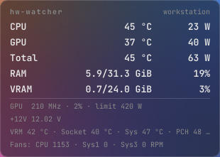
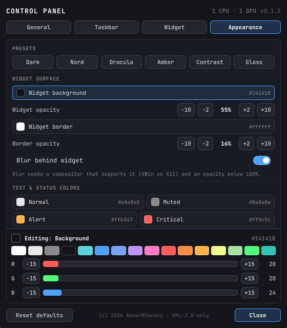

# HW Watcher

Lightweight Linux telemetry for CPU, GPU, motherboard, system RAM and GPU VRAM: a floating translucent panel, modular system-tray badges, a CLI inspector and an optional D-Bus daemon. Written in Rust with a software-rendered Slint UI, so it stays small and costs almost nothing while idle.

- Floating widget with per-row visibility, themes, opacity and compositor blur
- Up to 8 tray (taskbar) badges, ordered by priority, with a configurable tooltip
- Control Panel with four tabs: General, Taskbar, Widget, Appearance
- English UI with a bundled Portuguese translation
- Live readings only: nothing is recorded to disk

<p align="center">
  
  
</p>

<sub>Readings are from a real machine; the computer name in the header is an example (`HW_WATCHER_NAME`).</sub>

## Install

Download `hw-watcher-<version>-linux-<arch>.tar.gz` from the [Releases](../../releases) page:

```bash
tar xzf hw-watcher-*-linux-x86_64.tar.gz
cd hw-watcher-*/
./hw-watcher                            # run directly, nothing to install
./scripts/install.sh ./hw-watcher       # optional: ~/.local/bin, launcher, autostart and the `hww` alias
```

Or build from source with Rust 1.93+:

```bash
cargo build --release
./target/release/hw-watcher
```

`hw-watcher --version` prints the version and commit of your build. `hww` is a short alias.

## Quick start

```bash
hw-watcher                    # floating widget + tray badges
hw-watcher panel --tray       # start hidden in the tray
hw-watcher sample --json      # one reading and exit
hw-watcher follow --hz 2      # stream readings
hw-watcher panel --simulate   # try it without any hardware
```

Right-click the widget or the tray icon and choose **Control Panel** to change what is shown, the
colors, opacity and blur. Full instructions: [`docs/USAGE.md`](docs/USAGE.md).

## Compatibility at a glance

| | |
|---|---|
| OS | Linux (x86_64 verified, aarch64 untested). Prebuilt binaries need glibc 2.35+ |
| Display | X11 (verified), XWayland, experimental native Wayland |
| Tray | KDE Plasma (verified); other desktops need StatusNotifierItem support |
| GPU | NVIDIA (verified), AMD and Intel (implemented, untested) |
| CPU / board | AMD and Intel CPU temperature, RAPL power, `nct6687` and generic Super-I/O chips |

Unavailable sensors are hidden, never shown as errors. The detailed, honest status of every sensor
and desktop is in [`docs/COMPATIBILITY.md`](docs/COMPATIBILITY.md). Optional root-only sensors (CPU
power, VRAM temperature) need the daemon described in the usage guide.

## Security and privacy

No network code, no telemetry, nothing recorded to disk. Reading sensors needs no privileges; the
optional daemon runs as root with narrow capabilities and a read-only D-Bus interface. The project
has **not** been independently audited, and its `unsafe` code and dependencies are listed in
[`SECURITY.md`](SECURITY.md) along with how to verify official binaries and how to report a
vulnerability.

## Resource usage

Measured with a 250 ms refresh on an NVIDIA system: about 1% of one CPU core and roughly 32 MB PSS,
of which about 16 MB is the NVML library itself. A 1 s refresh cuts CPU use further.

## Repository layout

| Path | Contents |
|---|---|
| `crates/hw-watcher-core` | Sample model, thresholds, tray formatting (no unsafe code) |
| `crates/hw-watcher-proto` | D-Bus wire contract (no unsafe code) |
| `crates/hw-watcher-sensors` | NVML, DRM, hwmon, RAPL, meminfo, BAR0 and NVAPI readers |
| `crates/hw-watcher-panel` | The `hw-watcher` binary: UI, tray, daemon, CLI |
| `packaging/` | `systemd/` units, `dbus/` policy, `desktop/` entry |
| `scripts/` | `install.sh`, `hw-report.sh`, `release-notes.sh` |
| `docs/` | Usage, compatibility, architecture, releasing, provenance, screenshots |
| `.github/` | CI, release workflow, issue templates |

## Contributing

Contributions are welcome: see [`CONTRIBUTING.md`](CONTRIBUTING.md). For a sensor problem, run
`scripts/hw-report.sh` and open a hardware issue. Releases are described in
[`docs/RELEASING.md`](docs/RELEASING.md) and every change is recorded in
[`CHANGELOG.md`](CHANGELOG.md).

## License

HW Watcher is free software under the **GNU General Public License v3.0 only** (`LICENSE`),
Copyright (C) 2026 AbnerMSaconi. You may use, study, modify and redistribute it, but any copy or
derivative must keep the copyright notices, state its changes and be released under the same license
with its full source. Authorship marks and how to verify official releases are in [`docs/PROVENANCE.md`](docs/PROVENANCE.md). Third-party components, including the bundled JetBrains Mono font (OFL) and
Slint, are listed in `THIRD_PARTY.md`.
